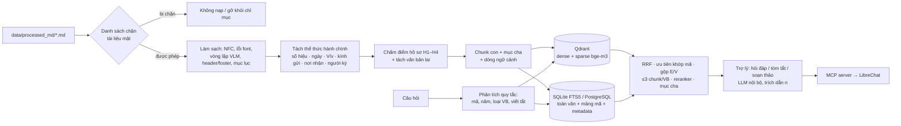

# Hanoi Metro AI Agent - Hệ Thống Xử Lý Tài Liệu & Lập Báo Cáo Tự Động
**Dự án:** Trợ lý AI Agent xử lý tài liệu kỹ thuật, tờ trình và tự động lập báo cáo cho **Công ty TNHH MTV Đường sắt Hà Nội (Hanoi Metro)**.  
**Giai đoạn 1:** Khung dự án & Ingestion Pipeline đa luồng (Page-level Classifier & OpenAI-compatible Parsers).

---

## 1. Kiến Trúc Tổng Thể (Giai Đoạn 1)

```mermaid
flowchart TD
    A[Thư mục PDF gốc: data/raw_pdfs/] --> B[Ingestion Pipeline: pipeline.py]
    B --> C{SQLite: state.db<br>Kiểm tra MD5 Hash}
    C -- Đã xử lý & Không đổi -- --> D[Bỏ qua - SKIPPED]
    C -- Mới hoặc đã thay đổi -- --> E[Đọc từng trang qua PyMuPDF & OpenCV]
    
    E --> F[Bộ phân loại trang: classifier.py]
    
    F -- Text tiếng Việt chuẩn, ít ảnh (<15%), không bảng phức tạp -- --> G[Luồng 1: DIRECT_TEXT<br>DirectTextParser]
    F -- Scan đánh máy ngay ngắn, rõ nét, văn bản thường -- --> H[Luồng 2: STANDARD_OCR<br>Docling / RapidOCR]
    F -- Bảng phức tạp AFC/OCC, scan mờ/nghiêng, chữ viết tay/CamScanner -- --> I[Luồng 3: VLM<br>Render 300 DPI + OpenAI VLM API]
    
    G --> J[Chuẩn hóa Markdown & Nối bảng liên trang]
    H --> J
    I --> J
    
    J --> K[Gắn Header Metadata YAML Frontmatter]
    K --> L[Lưu file kết quả: data/processed_md/{stem}.md]
    K --> M[Ghi nhận trạng thái hoàn tất vào SQLite]
```

---

## 2. Cấu Trúc Thư Mục Dự Án

```
hanoi_metro_agent/
├── docker-compose.yml       # Khởi chạy Qdrant Vector DB (kèm volume local data/qdrant_storage)
├── requirements.txt         # Danh mục thư viện Python (PyMuPDF, OpenCV, OpenAI, Pydantic, v.v.)
├── .env.example             # Mẫu cấu hình môi trường cho VLM, LLM, Embedding, Qdrant
├── .env                     # File môi trường thực tế (chứa API Key & Base URL)
├── README.md                # Tài liệu hướng dẫn cài đặt và vận hành
├── data/
│   ├── raw_pdfs/            # Nơi đặt các tài liệu PDF đầu vào của Hanoi Metro
│   ├── processed_md/        # Nơi lưu trữ file Markdown đầu ra đã xử lý
│   └── state.db             # Cơ sở dữ liệu SQLite theo dõi trạng thái ingestion
└── src/
    ├── __init__.py
    ├── config.py            # Quản lý cấu hình tập trung từ .env bằng Pydantic
    └── ingestion/
        ├── __init__.py
        ├── classifier.py    # Logic phân loại trang bằng PyMuPDF + OpenCV (DIRECT_TEXT, STANDARD_OCR, VLM)
        ├── parsers.py       # Triển khai 3 parser (DirectText, StandardOCR, VLM kèm System Prompt Metro)
        └── pipeline.py      # Điều phối pipeline, quản lý state.db, nối bảng và CLI
```

---

## 3. Hướng Dẫn Cài Đặt Môi Trường (Windows & Server)

### Bước 1: Tạo môi trường ảo Python
Khuyến nghị sử dụng Python 3.10, 3.11 hoặc 3.12:
```powershell
# Chuyển vào thư mục dự án
cd hanoi_metro_agent

# Tạo môi trường ảo
python -m venv venv

# Kích hoạt môi trường ảo trên Windows PowerShell
.\venv\Scripts\Activate.ps1
```

### Bước 2: Cài đặt các gói phụ thuộc
```powershell
pip install --upgrade pip
pip install -r requirements.txt
```

### Bước 3: Khởi chạy Qdrant & Ollama bằng Docker
Dành cho môi trường dev local để lưu trữ vector và tự host VLM:
```powershell
docker compose up -d
```
- **Qdrant Web Dashboard:** [http://localhost:6333/dashboard](http://localhost:6333/dashboard) (lưu tại `./data/qdrant_storage/`)
- **Ollama API:** [http://localhost:11434](http://localhost:11434) (weights lưu tại `./data/ollama_storage/`)

### Bước 4: Tải mô hình VLM về Ollama
Nếu bạn chạy Ollama (trực tiếp trên Windows hoặc qua container Docker ở bước 3):
```powershell
# Tải model Vision khuyến nghị (chuyên xử lý bảng biểu & chữ viết tay)
ollama run llama3.2-vision:11b

# Hoặc tải model tối ưu tiếng Việt và tài liệu kỹ thuật
ollama run qwen2.5-vl:7b
```

---

## 4. Cấu Hình Tự Host VLM Qua Ollama (`.env`)

Toàn bộ luồng bóc tách VLM hiện đã được cấu hình **chạy hoàn toàn nội bộ thông qua mô hình tự host trên Ollama**, không phụ thuộc vào Internet hay Cloud API:

```ini
# Cấu hình VLM tự host nội bộ qua Ollama
VLM_PROVIDER=ollama
VLM_BASE_URL=http://localhost:11434
VLM_API_KEY=ollama
VLM_MODEL_NAME=llama3.2-vision:11b
VLM_TEMPERATURE=0.1
VLM_MAX_TOKENS=4096
VLM_TIMEOUT_SECONDS=180

# Cấu hình LLM & Embedding (cũng có thể tự host qua Ollama)
LLM_BASE_URL=http://localhost:11434/v1
LLM_API_KEY=ollama
LLM_MODEL_NAME=qwen2.5:14b

EMBEDDING_BASE_URL=http://localhost:11434/v1
EMBEDDING_API_KEY=ollama
EMBEDDING_MODEL_NAME=bge-m3
```

---

## 5. Vận Hành Ingestion Pipeline

### 5.1. Thêm tài liệu PDF vào thư mục
Đặt các file PDF (biên bản khảo sát, tờ trình, báo cáo kỹ thuật Tuyến 2A, Tuyến 3.1, hồ sơ AFC, báo giá thiết bị Cisco, HPE, Dell) vào thư mục:
```
data/raw_pdfs/
```

### 5.2. Chạy Pipeline bóc tách tự động
```powershell
# Chạy toàn bộ tài liệu trong data/raw_pdfs/
python -m src.ingestion.pipeline

# Chỉ chạy phân loại (Dry-run: kiểm tra luồng classifier mà không tốn token gọi VLM)
python -m src.ingestion.pipeline --dry-run

# Bắt buộc xử lý lại toàn bộ file (bỏ qua cache SQLite)
python -m src.ingestion.pipeline --force

# Xử lý một file PDF cụ thể
python -m src.ingestion.pipeline --file "data/raw_pdfs/Bien_ban_thiet_bi_DC_Duy_Tan.pdf"

# Xem thống kê số lượng file và loại trang đã xử lý trong state.db
python -m src.ingestion.pipeline --status
```

---

## 6. Tiêu Chí Phân Loại Trang & System Prompt

### 6.1. Logic phân loại trang (Page Classifier)
| Luồng | Điều kiện kỹ thuật nhận diện | Parser đảm nhiệm |
| :--- | :--- | :--- |
| **`DIRECT_TEXT`** | Lớp text tiếng Việt chuẩn, không lỗi mã hóa CID/font, diện tích ảnh $\le 15\%$, không phát hiện lưới ô bảng biểu phức tạp. | `DirectTextParser` (PyMuPDF blocks + pdfplumber) |
| **`STANDARD_OCR`** | Trang scan dạng ảnh, độ sắc nét cao (Laplacian variance $\ge 90$), độ nghiêng $\le 1.5^\circ$, văn bản đánh máy bố cục thông thường. | `StandardOCRParser` (Docling / RapidOCR) |
| **`VLM`** | Phát hiện bảng biểu kỹ thuật $\ge 4$ ô lưới hoặc $\ge 8$ điểm giao; trang scan bị mờ/nghiêng; có dấu hiệu CamScanner/bóng tối góc do chụp điện thoại; chữ viết tay/con dấu phê duyệt. | `VLMParser` (Render 300 DPI Base64 + OpenAI VLM API) |

### 6.2. System Prompt chuyên biệt cho VLM Hanoi Metro
System Prompt được tối ưu hóa chuyên sâu:
- **Chuẩn hóa thể thức hành chính:** Nghị định 30/2020/NĐ-CP (Quốc hiệu, Tiêu ngữ, Số ký hiệu, Trích yếu, Chữ ký, Dấu đỏ).
- **Từ điển thuật ngữ:** AFC (TVM, AG, BOM, PCA, Thẻ thông minh), OCC, Tuyến 2A (Cát Linh - Hà Đông), Tuyến 3.1 (Nhổn - Ga Hà Nội), Thiết bị mạng & máy chủ (Cisco, HPE, Dell, Fortigate, APC UPS, Tủ Rack DC Duy Tân).
- **Chuẩn bảng biểu Markdown:** Giữ nguyên 100% cột, đơn giá, số lượng; tự động nối liền nếu bảng kéo dài sang trang tiếp theo.
- **Nhận diện chữ viết tay:** Ghi chú rõ `[Viết tay: ...]`, `[Chữ ký: ...]`, `[Dấu đỏ: ...]`.

---

## 7. Giai Đoạn 3: Trợ Lý Tài Liệu (Hỏi đáp · Tóm tắt · Soạn báo cáo)

Triển khai theo *Đề xuất giải pháp công nghệ số hóa RAG Hanoi Metro v6* (Mục 4–5): chunking theo 4 hồ sơ,
tìm kiếm lai 2 nhánh dùng chung `chunk_id`, trích dẫn về đúng file và trang, MCP server cho LibreChat.



### 7.1. Cấu trúc mã nguồn mới

```
src/
├── text/          normalize.py (NFC, lỗi font, chữ dính, vòng lặp VLM) · codes.py (số hiệu, mã) · abbrev.py (từ điển viết tắt)
├── indexing/      document.py · structure.py (làm sạch, thể thức, đề mục, bảng) · profiles.py (H1–H4)
│                  structured.py (chunker theo hồ sơ, parent–child) · indexer.py (danh sách chặn, nạp tăng dần)
├── store/         base.py (giao diện adapter) · sqlite.py · postgres.py · vector.py (Qdrant)
├── retrieval/     query.py (phân tích câu hỏi) · engine.py (2 nhánh song song, RRF, đa dạng hóa, mục cha)
├── agent/         assistant.py (ask · summarize · draft_report · list · read) · prompts.py · llm.py · mcp_server.py
├── eval/          bakeoff.py (Recall@5/10, MRR, p95 theo loại câu hỏi; C1 / C2 / C4)
├── runtime.py     ghép thành phần theo .env
└── cli.py
data/dictionaries/synonym_dict.json   từ điển viết tắt (approved=true mới được dùng)
data/eval/questions.jsonl             bộ câu hỏi mẫu (mở rộng tới ~120 câu)
```

### 7.2. Vận hành

```powershell
# Nạp chỉ mục (tăng dần: văn bản không đổi được bỏ qua; --force để nạp lại)
python -m src.cli index
python -m src.cli status            # thống kê + danh sách văn bản cần rà soát hồ sơ chunking

# Tra cứu & trợ lý
python -m src.cli search "916/CV-VT&QLPT"                     # xem đoạn trích, không gọi LLM
python -m src.cli ask "Thiết bị nào tại DC Duy Tân bị hỏng?"
python -m src.cli summarize "916/CV-VT&QLPT" --style chi_tiet # ngan | gach_dau_dong | chi_tiet
python -m src.cli report "Kết quả kiểm đếm thiết bị DC Duy Tân" --type bao_cao --unit "Phòng VT&QLPT" --out du_thao.md
python -m src.cli list --loai CV QĐ --from 2024 --to 2024 --keyword "bảo hiểm"

# Đánh giá thu nhỏ C1 (vector) / C2 (từ khóa) / C4 (lai)
python -m src.cli eval data/eval/questions.jsonl

# Ứng viên viết tắt khai thác từ kho để văn thư duyệt rồi thêm vào synonym_dict.json
python -m src.cli mine-abbrev

# Kiểm thử
python -m pytest
```

### 7.3. Kết nối LibreChat (đã cấu hình sẵn)

1. Bật Docker Desktop (LibreChat + Qdrant `hanoi_metro_qdrant` tự chạy) và Ollama trên Windows.
2. Chạy `start_mcp.bat` (MCP server `127.0.0.1:8765/mcp`).
3. Mở http://localhost:3080, chọn **"Trợ lý tài liệu Hanoi Metro"** (mặc định cho chat mới) và đặt câu hỏi.

Cấu hình trong `librechat.yaml`:
- `endpoints.custom` **Ollama (nội bộ)** → `http://host.docker.internal:11434/v1`, mô hình `hanoi-metro-qwen2.5:3b`
  (= `qwen2.5:3b` cố định context 16k, tạo từ `ollama/Modelfile.qwen2.5-3b-16k`, vì LibreChat gọi Ollama qua `/v1`
  nên không truyền được `num_ctx`, còn máy đang đặt `OLLAMA_CONTEXT_LENGTH=4096`).
- `modelSpecs` **Trợ lý tài liệu Hanoi Metro**: endpoint Ollama nội bộ, gắn sẵn MCP `hanoi-metro-docs`, lời dặn bắt
  mô hình gọi công cụ ngay và chép nguyên văn kết quả (mô hình 3B tự viết lại hay làm sai).
- MCP `hanoi-metro-docs` có `chatMenu: false`: người dùng không tự bật được công cụ này cho GPT/Claude/Gemini,
  nên tài liệu nội bộ chỉ đi tới mô hình Ollama chạy trên máy. (Agent do người dùng tự tạo trong Agent Builder vẫn
  có thể gắn MCP này — nếu cần chặn hẳn, giới hạn quyền tạo Agent hoặc nhà cung cấp cho phép của Agent.)
- Container `hanoi_metro_ollama` trong `docker-compose.yml` đã chuyển sang profile `ollama-docker`: nó trùng cổng
  11434 với Ollama Windows và có kho model khác, từng làm mất `qwen2.5:3b` khỏi tầm nhìn của hệ thống.

### 7.4. Lưu ý

- **Qdrant**: khi Docker chạy, hệ thống dùng Qdrant server (`hanoi_metro_qdrant`); chỉ khi không kết nối được mới dùng
  Qdrant nhúng `data/qdrant_local` (một tiến trình). Hai nơi lưu khác nhau: đổi chế độ thì chạy lại `index --force`.
- **Mô hình nhỏ** (`qwen2.5:3b`) hay bỏ sót ý, quên trích dẫn và tự thêm chi tiết. Hệ thống tự gắn danh sách nguồn,
  lọc nguồn theo mức trùng nội dung khi mô hình không ghi `[n]`, và cảnh báo số liệu/mã không có trong tài liệu
  nguồn — nhưng nên dùng `qwen2.5:7b`/`14b` trở lên cho tóm tắt và soạn thảo.
- **PostgreSQL** (`KEYWORD_BACKEND=postgres`): cần `pip install "psycopg[binary]" psycopg_pool`, quyền
  `CREATE EXTENSION unaccent, pg_trgm`. Lược đồ tạo tự động theo Mục 5.4.

---

## 8. Phương Án 3: LLM & VLM Qua API, Dịch Vụ Hỏi Đáp 1 Lượt

Tài liệu có dấu chỉ độ mật (danh sách chặn của page_router) không bao giờ được bóc tách, lập chỉ mục hay gửi ra API:
kiểm tra ở khâu bóc tách (bỏ cả file), khâu nạp chỉ mục, và **lại ngay trước mỗi lần gửi** trang (VLM) hoặc đoạn
tài liệu (LLM) ra dịch vụ bên ngoài. Tìm kiếm và embedding (bge-m3) vẫn chạy nội bộ.

### 8.1. Dịch vụ hỏi đáp 1 lượt (`src/gateway/server.py`, chạy `start_gateway.bat`)

API tương thích OpenAI tại `127.0.0.1:8766/v1`, khai báo trong LibreChat là endpoint **Hanoi Metro**
(khóa `GATEWAY_API_KEY` ↔ `HANOI_METRO_GATEWAY_KEY` trong `.env` của LibreChat). Mỗi tin nhắn: tìm kiếm 2 nhánh →
gọi LLM **đúng 1 lần** → phát trực tiếp câu trả lời + nguồn. Không còn lượt "Agent quyết định gọi công cụ" và
không còn khâu mô hình chép lại kết quả.

| Mô hình trong LibreChat | Dùng cho |
|---|---|
| Hỏi đáp tài liệu Hanoi Metro | Câu hỏi thường (hiểu câu hỏi nối tiếp); lệnh `/tomtat`, `/baocao`, `/lietke`, `/help` |
| Tóm tắt văn bản | Nhập số hiệu / mô tả; thêm "ngắn", "gạch đầu dòng" |
| Soạn thảo văn bản | Nhập chủ đề; "tờ trình", "công văn", "tổng hợp" đổi loại; số hiệu trong câu làm căn cứ |

MCP server (`start_mcp.bat`) vẫn giữ cho Agent LibreChat nếu cần, nhưng không còn là đường chính.

### 8.2. VLM qua API (`src/ingestion/cloud_vlm.py`)

`VLM_PROVIDER=gemini` → trang Luồng 3 gửi Gemini 2.5 Flash (tắt thinking). Kiểm soát theo Mục 6 báo cáo dự toán:

- **Mỗi trang gọi một lần**: sổ `data/vlm_ledger.db` lưu kết quả theo (md5, trang, model, phiên bản prompt).
- **Hạn mức tự dừng**: `VLM_BUDGET_USD` (mặc định 1 USD để chạy thử); dừng trước khi gửi trang làm vượt hạn mức.
- **Chống vòng lặp**: nhận kết quả dạng stream, ngắt ngay khi mô hình lặp dòng (biểu mẫu nhiều hàng trống từng
  sinh 976 hàng rỗng, chạm trần 8.192 token), không trả tiền cho phần lặp.
- **Lỗi tạm thời** (429, 5xx): thử lại giãn cách; vẫn lỗi thì file đánh dấu thất bại để lần sau chạy lại.
- **Cắt 3 dải** (`VLM_STRIPS=3`, `IMAGE_DPI_VLM=200`): Gemini tính mỗi ảnh ~258 token (ảnh bị thu nhỏ); cả trang
  một ảnh đọc sai ngày viết tay 2/2 lần, 3 dải đọc đúng 2/2.
- Xem token/chi phí thực đo và ước tính cho 3 kịch bản: `python -m src.ingestion.cloud_vlm`.

### 8.3. Lưu ý vận hành

- **Gói API (nếu quay lại Gemini)**: key Gemini đang là **gói miễn phí (20 yêu cầu/ngày cho gemini-2.5-flash)** — không đủ chạy thật, và
  dữ liệu gói miễn phí có thể được Google dùng để cải thiện sản phẩm. Trước khi xử lý tài liệu thật: bật thanh toán
  (gói trả phí) cho project Google Cloud của key, xác nhận điều khoản không dùng dữ liệu để huấn luyện, rồi nâng
  `VLM_BUDGET_USD` theo ngân sách được duyệt.
- **Dữ liệu cũ do model 3B nội bộ bóc tách không đáng tin**: biên bản Duy Tân bị ghi "Bị hỏng" cho cả 3 thiết bị
  trong khi bản gốc ghi "Bình thường/BT". Dữ liệu mẫu đã bóc tách lại bằng Gemini.
- Chữ số viết tay vẫn có thể đọc sai (serial N3K93180 lúc đọc N3K, lúc N9K): cần rà soát với tài liệu quan trọng.

### 8.4. Nhà cung cấp hiện dùng: OpenAI gpt-6-luna (cả hỏi đáp và VLM)

So sánh trên trang biên bản viết tay (4 tiêu chí đối chiếu ảnh gốc: ngày, serial N3K93180, tình trạng 3 thiết bị,
tên người), mỗi model chạy 3 lần, gửi cả trang 1 ảnh `detail=high`:

| Model | Đúng | USD/trang (giá tham khảo) |
|---|---|---|
| gpt-6-luna | 12/12 | ~0,00067 |
| gpt-5-mini | 8/12 | ~0,0020 |
| gpt-5.4-mini / gpt-5.4-nano | 1–3/4 mỗi lần | 0,0017–0,0051 |
| gemini-2.5-flash (3 dải) | ~3/4 | ~0,0021 |

Với OpenAI không cần cắt dải (`VLM_STRIPS=1`): ảnh giữ độ phân giải, cắt dải chỉ làm tăng gấp đôi token vào.
Model OpenAI đời mới không nhận `max_tokens` (code tự dùng `max_completion_tokens`). Giá gpt-6-luna lấy từ trang tổng
hợp ($0,10 vào / $0,50 ra mỗi 1M token) — đối chiếu trang giá chính thức rồi sửa `VLM_PRICE_*` nếu khác.
Ước tính: kịch bản 2 (64.000 trang) ≈ 41 USD, Batch API ≈ 20 USD; hỏi đáp ≈ 0,0004 USD/câu.
Cấu hình Gemini để quay lại nằm ở dòng ghi chú cuối `.env`.

---

## 9. Bóc Tách Toàn Kho (`src/ingestion/corpus.py`)

Đọc thẳng kết quả page_router: `ingest_manifest.csv` (16.570 file được phép: đã loại trùng, đã loại tài liệu mật) và
`pages_routed.csv` (luồng từng trang). Kết quả lưu theo trang (`data/corpus.db`, sổ VLM `data/vlm_ledger.db`); file chỉ
được ghép thành Markdown (`data/corpus_md/<md5>.md`) khi đủ mọi trang → dừng lúc nào cũng chạy tiếp được.

| Luồng page_router | Số trang | Xử lý |
|---|---:|---|
| DIRECT_TEXT | 53.471 | PyMuPDF trên máy; bảng điện tử bằng `find_tables` đúng vị trí, không chép trùng; giữ xuống dòng trước "Điều", "1.", "a)" |
| STANDARD_OCR | 43.701 | **VLM API** (mặc định). RapidOCR mặc định mất dấu tiếng Việt ("CONGTYTNHHMTVDUONGSATHANOI") và ~6 s/trang; muốn dùng lại: `CORPUS_OCR_VIA=rapidocr` |
| VLM | 52.646 | VLM API |
| BLANK | 7.717 | Bỏ qua |

```powershell
python -m src.ingestion.corpus status                       # toàn kho; --filter "VB ĐI - 2026" --limit-files 8 để chọn phạm vi
python -m src.ingestion.corpus local --workers 4            # trang text gốc (trên máy, không tốn phí)
python -m src.ingestion.corpus batch-submit --batch-pages 500 --max-batches 2   # trang API qua Batch (−50%)
python -m src.ingestion.corpus batch-collect                # nhận kết quả (chạy lại tới khi hết Batch đang mở)
python -m src.ingestion.corpus vlm-sync --workers 6         # hoặc gọi trực tiếp (nhanh, giá thường)
python -m src.ingestion.corpus assemble                     # ghép Markdown các file đủ trang
python -m src.cli index --dir data/corpus_md                # nạp chỉ mục
```

- Batch: mỗi lô ≤ 500 trang và ≤ 180 MB (giới hạn file 200 MB); kiểm tra danh sách chặn từng trang và hạn mức
  `VLM_BUDGET_USD` (tính cả lô đang chờ) trước khi gửi; file JSONL chứa ảnh bị xóa ngay sau khi tải lên. Trang lỗi trong lô
  tự được gửi lại ở lần `batch-submit` sau. Batch không ngắt được vòng lặp giữa chừng như gọi trực tiếp, phần lặp
  được gộp khi nhận kết quả.
- Chi phí ước tính (giá tham khảo gpt-6-luna, đo 200 trang): 96.347 trang API × ~0,00072 USD ≈ 69 USD gọi thường,
  ≈ 35 USD Batch. Nâng `VLM_BUDGET_USD` theo ngân sách được duyệt trước khi chạy toàn kho.

## 10. Khởi động nhanh và mở tài liệu gốc

- Bấm đúp `start_all.bat`: bật Docker Desktop, Ollama, dịch vụ hỏi đáp (cửa sổ thu nhỏ "Hanoi Metro Gateway") rồi mở LibreChat.
- Mỗi nguồn [n] trong câu trả lời là liên kết mở file PDF gốc đúng trang được trích (`/tai-lieu/<doc_id>/<tên file>?k=<chữ ký>#page=N`).
  - Liên kết có chữ ký HMAC theo văn bản: không sửa URL để mở văn bản khác được.
  - Danh sách chặn tài liệu mật được kiểm tra lại mỗi lần mở; chỉ phục vụ file trong `DOC_ROOTS`.
  - Triển khai lên server: đặt `DOC_LINK_BASE_URL` thành địa chỉ người dùng truy cập được và mở cổng gateway trong mạng nội bộ.

## 11. Phân quyền theo phòng ban

Quyền là **tra bảng**, không do AI quyết định. Mô hình ngôn ngữ chỉ nhận các đoạn đã qua bộ lọc, nên không thể mở rộng quyền.

| Thành phần | File | Ai cập nhật |
|---|---|---|
| Danh mục đơn vị (9 phòng ban theo QĐ 503–510/QĐ-ĐSHN + XN2, XN3, XNBT) | `config/access/phong_ban.yaml` | Quản trị |
| Vai trò → phạm vi xem, chức năng | `config/access/vai_tro.yaml` | Quản trị |
| Người dùng (email LibreChat → phòng, vai trò) | `config/access/nguoi_dung.csv` | Phòng TCNS / quản trị |
| Cấp riêng từng văn bản | `config/access/cap_rieng.csv` | Quản trị |
| Văn bản → phòng (nhãn đã duyệt) | bảng `doc_access` (nạp bằng lệnh dưới) | Người có thẩm quyền duyệt |

### Khai báo đơn vị khi bắt đầu dùng

Người dùng đăng ký LibreChat như bình thường. Lần đầu nhắn cho trợ lý, gateway trả hướng dẫn và danh mục đơn vị
(không gọi LLM). Người dùng gõ `/phongban <MÃ> <Họ và tên>` → khai báo **chờ duyệt** (`data/access/dang_ky.csv`).
Email lấy từ phiên đăng nhập LibreChat, người dùng không tự khai email.

| Ai | Lệnh trong khung chat |
|---|---|
| Mọi người | `/phongban` (xem trạng thái), `/phongban KHDA Nguyễn Văn A` (khai báo / xin đổi đơn vị) |
| Trưởng phòng (`duyet: phong_minh`) | `/choduyet`, `/duyet <email>` (chỉ đơn vị mình, chỉ cấp `nhan_vien`), `/tuchoi <email> <lý do>` |
| Quản trị (`duyet: tat_ca`) | như trên, mọi đơn vị, `/duyet <email> <vai_tro>` |

Duyệt = ghi một dòng vào `nguoi_dung.csv`; gateway tự nạp lại file nên có hiệu lực ngay. Dòng lệnh tương đương:
```
python -m src.access.users them <email> --phong VP --vai-tro quan_tri --ho-ten "..."   # tài khoản quản trị đầu tiên
python -m src.access.users cho-duyet
python -m src.access.users duyet <email> [--vai-tro nhan_vien]
python -m src.access.users tu-choi <email> --ly-do "..."
python -m src.access.users danh-sach
```
Tùy chọn trong `vai_tro.yaml` → `khai_bao_phong_ban`: `tu_dong_duyet` (chỉ để thí điểm – ai cũng chọn được đơn vị bất kỳ),
`ten_mien_email` (chỉ email công ty được khai báo; nên đặt thêm `registration.allowedDomains` trong `librechat.yaml`).
Lệnh khai báo chạy cả khi `ACCESS_CONTROL=off`, để thu thập khai báo trước khi bật phân quyền.

Gán nhãn văn bản (gợi ý → duyệt trong Excel → nạp; chỉ cột `phong_duyet` có hiệu lực):
```
python -m src.access.labels goi-y                    # ghi data/access/nhan_van_ban.csv
python -m src.access.labels ap-dung --file data/access/nhan_van_ban.csv
python -m src.access.labels thong-ke
python -m src.access.labels ung-vien --phong VTQLPT   # danh sách ứng viên một phòng (luật + AI + từ khóa tu_khoa), để duyệt
```
Bật: `ACCESS_CONTROL=on` trong `.env`, khởi động lại gateway; LibreChat gửi email qua header `X-User-Email`
(`librechat.yaml`, cần `docker compose restart api` sau khi sửa).

- Mặc định chặn: văn bản chưa gán nhãn chỉ vai trò `xem: tat_ca` thấy; người chưa khai báo / chưa được duyệt không thấy gì
  (hoặc chỉ tài liệu chung nếu `nguoi_dung_chua_dang_ky: chi_tai_lieu_chung`).
- Tra đích danh số hiệu / doc_id, `/lietke`, tóm tắt, soạn thảo, mở file gốc đều qua cùng bộ lọc.
- Liên kết mở file gắn với người dùng (mã băm, không chứa email), hết hạn sau `DOC_LINK_TTL_HOURS`, kiểm tra lại quyền lúc mở.
- Đổi nhãn chỉ sửa payload Qdrant, không tạo lại vector. Nạp lại văn bản giữ nguyên nhãn.
- Máy chủ MCP bị khóa khi bật phân quyền (chưa nhận diện người dùng).
- Nhật ký `data/access_log.jsonl`: thời điểm, email, phòng, chức năng, doc_id được trả (không ghi câu hỏi).

## 12. Bổ sung metadata văn bản (`src/indexing/enrich.py`)

Phần ưu tiên 1 của bộ 120 tiêu chí (chi tiết: `docs/Doi_chieu_120_tieu_chi_voi_he_thong_v1.md`, mục 4.1, 5, 6).
**Không sửa `DocRecord`, không tăng `CHUNKER_VERSION`**: kết quả nằm ở bảng riêng trong kho văn bản, không phải nhúng lại.

| Bảng | Nội dung |
|---|---|
| `doc_fields` | `(doc_id, truong, gia_tri, nguon, do_tin_cay, trang, phien_ban_bo_trich, nguoi_duyet, ghi_chu, cap_nhat)` |
| `doc_relations` | `(doc_id, loai, so_hieu_dich, doc_id_dich, trang, nguon)`; `loai`: can_cu, tra_loi, thay_the, bai_bo, sua_doi, kem_theo, lien_quan |
| `doc_tasks` | `(doc_id, phong, nguoi, noi_dung, han, loai_han, trang, nguon='ai')` |

`nguon`: `luat` / `ai` / `duyet`. Giá trị nguồn thấp không ghi đè nguồn cao (ai < luat < duyet).
**Phân quyền chỉ dùng nhãn đã duyệt** (bảng `doc_access`); giá trị AI chỉ để hiển thị, ghi rõ "do AI trích / cần kiểm tra".
Hiện mới cài đặt trên SQLite; giao diện đã có trong `src/store/base.py`, PostgreSQL báo `NotImplementedError`.

```
python -m src.indexing.enrich chay                  # chỉ luật, không gọi API
python -m src.indexing.enrich chay --ai --limit 200 # thêm bước AI, chạy thử 200 văn bản (tốn phí)
python -m src.indexing.enrich thong-ke
python -m src.indexing.enrich chay --chi-trang-thai    # chỉ tính lại trạng thái hiệu lực (vài giây)
```

**Bằng luật:** `huong_vb` (di/den/noi_bo/khong_ro: thư mục "CV ĐI"/"CV ĐẾN"; "đến" chỉ khi có số hiệu …/… và tên cơ quan thật – tài liệu kỹ thuật để không rõ),
quan hệ văn bản (dòng "Căn cứ…", "Phúc đáp/Trả lời công văn số…", "thay thế/bãi bỏ/sửa đổi…", "kèm theo…"; bãi bỏ/thay
thế một điều, khoản được tính là sửa đổi; `doc_id_dich` điền khi số hiệu đích có đúng trong kho), `hieu_luc_tu`,
`trang_thai_hieu_luc` + `thay_the_boi` (đảo chiều quan hệ; không tính văn bản nguồn cũ hơn, khác cơ quan ban hành, hoặc chỉ nhắc tới dự thảo),
`ty_le_trang_scan` (pages_routed.csv), `ty_le_doc_duoc`, `trang_can_scan_lai` (sổ cái VLM: trang rỗng, chạm trần token,
từ 3 chỗ "[không rõ]"; trang chưa nhận dạng cũng làm giảm tỷ lệ đọc được). `huong_vb`, `trang_thai_hieu_luc` được
ghi thêm vào payload Qdrant (cập nhật payload, không nhúng lại).

**Trong trợ lý:** `Filters.huong_vb`; `/lietke công văn đến năm 2025`, `/lietke văn bản đi …`. Khi trích văn bản bị
thay thế / bãi bỏ: ghi chú kèm số hiệu văn bản thay thế. Văn bản có `ty_le_doc_duoc` < `ENRICH_LOW_READ_RATIO`: ghi
chú "đọc kém, nên xem bản gốc" và các trang cần scan lại.

**Bước AI (mặc định tắt, `--ai`):** một lượt gọi LLM mỗi văn bản (trang đầu + trang cuối, danh mục `phong_ban.yaml`)
→ phòng chủ trì / phối hợp kèm lý do và nhiệm vụ (ai, làm gì, hạn, trang). Mã đơn vị ngoài danh mục, trang ngoài văn
bản, hạn sai định dạng bị bỏ. Gợi ý phòng được ghép vào cột `phong_goi_y` của `data/access/nhan_van_ban.csv` (không áp
thẳng; `phong_duyet` giữ nguyên). Trước mỗi lần gửi: kiểm tra danh sách chặn tài liệu mật (thiếu danh sách → dừng) và
hạn mức `ENRICH_AI_BUDGET_USD` (riêng với `VLM_BUDGET_USD`, chi phí ước tính theo số token). Văn bản đã xử lý ở cùng
phiên bản không gọi lại (`data/enrich_ai_ledger.sqlite`, có lưu phản hồi gốc và số token thật do API trả về).
Bước AI dùng mức suy luận `ENRICH_REASONING_EFFORT` (mặc định `low`), riêng với `LLM_REASONING_EFFORT` của gateway:
với `none` mô hình trả mảng rỗng cho hầu hết văn bản.

Kiểm thử độ chính xác trên mẫu nhỏ trước khi chạy lớn:
```
python -m src.indexing.enrich chay --ai --chi-ai --ngau-nhien --limit 20   # ghi phiếu data/access/kiem_tra_enrich.csv
python -m src.indexing.enrich xuat-kiem-tra
```
Mỗi văn bản chỉ một phòng chủ trì (mô hình trả nhiều phòng → giữ phòng đầu, các phòng sau chuyển sang phối hợp).
Đổi cách đọc kết quả thì áp lại lên phản hồi gốc đã lưu, không gọi API: `python -m src.indexing.enrich tinh-lai-ai`.
Phiếu kiểm tra đã có người điền (cột `dung_*`, `phong_dung`, `ghi_chu`) không bị ghi đè.
